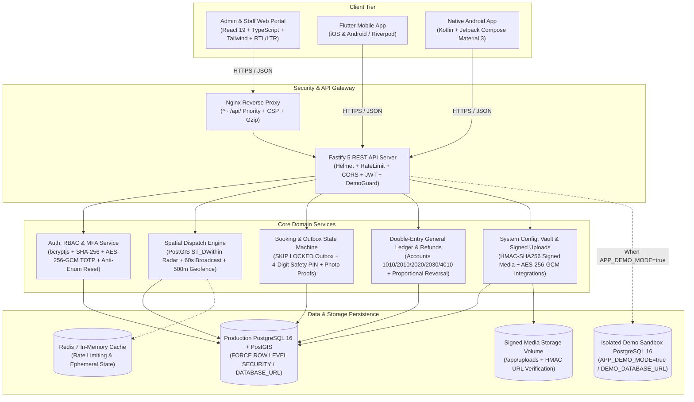

# ServicePro OS — Enterprise Technical Architecture Specification

> **Document Version**: 3.0.0 (Universal Turnkey & Dual-DB Release)  
> **Target Audience**: Technical Due Diligence Teams, Lead Software Architects, Systems Integrators  
> **System Classification**: Multi-Tenant On-Demand Service Dispatch, PostGIS Spatial Radar & Double-Entry General Ledger Platform  

---

## 1. System Topology & Component Boundaries



---

## 2. Database Migration Architecture (15 Paired Up/Down Migrations)

The PostgreSQL 16 + PostGIS schema is partitioned into **15 forward migrations (`001`–`015`)** with **15 matching `.down.sql` rollback scripts** in `server/src/database/migrations/`:

1. **`001_tenants_and_auth.sql`**:
   - `tenants`: Multi-tenant boundary with subdomain `slug`, `custom_domain`, branding, currency, commission basis points (`default_platform_commission_bps`), and active flags.
   - `users`, `user_sessions`, `user_mfa_credentials`, `permissions`, `role_permissions`.
2. **`002_profiles_and_entities.sql`**:
   - `admin_profiles`, `staff_profiles`, `customer_profiles`, `provider_profiles`.
   - `provider_locations` & `customer_addresses`: PostGIS `GEOGRAPHY(Point, 4326)` with GIST spatial indexing.
   - `provider_shifts`: Day-of-week shift schedules.
3. **`003_services_and_catalog.sql`**:
   - `service_categories`, `services`, `service_pricing_tiers` (`STANDARD`, `URGENT`, `EMERGENCY`).
4. **`004_bookings_and_dispatch.sql`**:
   - `bookings`, `dispatch_broadcasts`, `booking_timeline_events`, `work_order_proofs`.
5. **`005_finance_and_ledger.sql`**:
   - `invoices`, `invoice_items`, `payment_transactions`, `webhook_events`, `ledger_accounts`, `ledger_entries`, `provider_payouts`.
6. **`006_support_crm_and_audit.sql`**:
   - `support_tickets`, `ticket_messages`, `customer_reviews`, `notification_logs`, `audit_logs`, `tenant_cms_configs`, `installer_provision_logs`.
7. **`007_finance_invoices_patch.sql`**:
   - Adds `invoices.updated_at` and expands `payment_transactions` state check (`VOIDED`, `DISCREPANCY_QUARANTINED`), with data-loss guardrails in `007.down.sql`.
8. **`008_payout_tenant_idempotency_and_durability.sql`**:
   - Enforces compound `UNIQUE (tenant_id, idempotency_key)` and request fingerprinting on `provider_payouts`.
9. **`009_ledger_payout_and_booking_references.sql`**:
   - Adds `payout_id`, `booking_id`, and `posting_type` with unique partial indexes (`uq_ledger_payout_posting`, `uq_ledger_tx_posting`) to eliminate text-matching ledger deduplication.
10. **`010_payment_outbox_and_state_hardening.sql`**:
    - Durable payment outbox (`payment_outbox`) with `FOR UPDATE SKIP LOCKED` lease worker, atomic PIN attempt counters, and strict booking status constraints.
11. **`011_remediation_schema_rbac_and_triggers.sql`**:
    - Canonical role normalization (`ADMIN`, `STAFF`, `TECHNICIAN`, `CUSTOMER`) and automatic `updated_at` triggers.
12. **`012_security_rls_immutability_and_indexes.sql`**:
    - Append-only immutability trigger on `ledger_entries` (`prevent_ledger_entry_mutation`) and tenant Row-Level Security policies.
13. **`013_security_rls_force_vat_and_uae_settings.sql`**:
    - Enables `FORCE ROW LEVEL SECURITY` across all tenant-scoped tables, adds regional tax/locale metadata on `tenants`, and seeds Account `2030` (`Tax / VAT Payable Liability`).
14. **`014_universal_tax_refunds_and_rls_helpers.sql`**:
    - Adds `payment_refunds` table with durable state machine (`PROCESSING` -> `SUCCEEDED` / `FAILED`), `refunded_amount_cents` tracking, and `SECURITY DEFINER` RLS auth helpers (`app_auth_login_lookup`, `app_auth_session_lookup`, `app_resolve_booking_tenant`).
15. **`015_phase2_auth_resets_and_encrypted_integrations.sql`**:
    - Adds `password_reset_tokens` (SHA-256 token hashes with `SECURITY DEFINER` anti-enumeration lifecycle helpers) and expands `integration_configs` with AES-256-GCM encrypted third-party credential vault columns plus `public_settings` JSONB.

---

## 3. Financial Engine, Pre-Tax Commission & Double-Entry Ledger

To eliminate floating-point rounding leakage, ServicePro OS stores all monetary quantities as 64-bit integer cents (`BIGINT`) and serializes them safely across REST responses.

### Universal Pre-Tax Commission & Account `2030` Tax Accounting

Consider a completed booking with a pre-tax subtotal of `10,000` cents (`100.00`), a `5%` VAT rate (`500` bps = `500` cents tax), a gross invoice total of `10,500` cents (`105.00`), and a `15%` platform commission (`1500` bps on pre-tax subtotal = `1,500` cents commission, `8,500` cents technician net payout):

```
1. Customer Payment Capture (Gross = 10,500 cents):
   Debit:   1010 Operating Bank Account (Asset)           +10,500
   Credit:  2010 Customer Escrow Liability (Liability)    +10,500

2. Job Completion Settlement (Pre-Tax Split + Account 2030 VAT Isolation):
   Debit:   2010 Customer Escrow Liability (Liability)    -10,500
   Credit:  2030 Tax / VAT Payable Liability (Liability)     +500
   Credit:  4010 Platform Commission Revenue (Revenue)     +1,500
   Credit:  2020 Technician Payable (Liability)            +8,500

3. Technician Payout Disbursal:
   Debit:   2020 Technician Payable (Liability)            -8,500
   Credit:  1010 Operating Bank Account (Asset)            -8,500
```

When a full or partial refund (`POST /api/v1/finances/refunds`) is executed:
- If the job is still in escrow (pre-completion), the refund debits `2010` and credits `1010`.
- If the job was already settled, the refund proportionally reverses `2030` (Tax Payable), `4010` (Platform Commission Revenue), and `2020` (Technician Payable) against `1010` (Operating Bank) using deterministic idempotent `posting_type` keys (`REFUND_SETTLED_TAX:<refundId>`, `REFUND_SETTLED_REV:<refundId>`, `REFUND_SETTLED_PAYABLE:<refundId>`).

---

## 4. Security & Multi-Tenant Isolation Architecture

- **Non-Superuser `FORCE ROW LEVEL SECURITY`**:
  - Every request runs inside an `AsyncLocalStorage` tenant context (`tenantContextStorage`) that sets `SET LOCAL app.current_tenant_id` on checked-out pool connections, preventing cross-tenant data leakage even under `NOBYPASSRLS` database roles.
- **Cryptographic Secret Storage**:
  - Passwords hashed with `bcryptjs` (cost 10).
  - Access tokens expire in 15m; refresh tokens use SHA-256 hashing with rotation and reuse detection.
  - TOTP MFA secrets (`user_mfa_credentials`) and third-party API keys (`integration_configs`) are encrypted at rest using AES-256-GCM (`APP_ENCRYPTION_KEY`).
  - Uploaded job proof images and brand logos are served via expiring HMAC-SHA256 signed URLs (`/api/v1/uploads/:tenantId/:filename?exp=...&sig=...`) with `X-Content-Type-Options: nosniff`.
